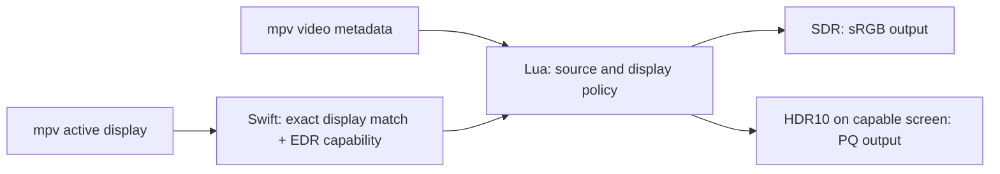

# mpv-chameleon

*Your video adapts to your display.*

[](https://github.com/jakeberv/mpv-chameleon/actions/workflows/ci.yml)

Automatic, display-aware HDR/SDR switching for mpv on macOS.

mpv-chameleon reads the current display's Extended Dynamic Range (EDR)
capability and the video's effective color metadata. It selects HDR10/PQ output
only for a PQ/BT.2020 source on an HDR-capable display. SDR video stays SDR,
including on a MacBook's XDR display. Move playback to an SDR display and HDR10
is tone-mapped to sRGB; move it back and the original HDR processing settings
are restored.

This is an independent, small utility: one Lua script and one locally compiled
Swift helper. No daemon, network access, telemetry, hard-coded monitor models,
admin privileges, or runtime package dependencies beyond mpv and macOS.

**Initial implementation; no tagged release has been published.** Read the [tested configurations and
limitations](docs/compatibility.md) and [verification report](docs/verification.md).
Correct signaling is not evidence of instrument-calibrated color accuracy.

## Install

Requirements: macOS 10.15+ APIs, an mpv **0.41+** build with `gpu-next`, Vulkan
and `macvk`, and the Swift compiler from Xcode Command Line Tools. A particular
mpv distribution may require a newer macOS. Apple Silicon is the tested platform;
Intel is not yet verified. Homebrew mpv is the tested distribution.

Clone the repository, review the dry run, then install:

```sh
git clone https://github.com/jakeberv/mpv-chameleon.git
cd mpv-chameleon
./install.sh --dry-run
./install.sh
```

If Swift is missing, run `xcode-select --install`. If mpv is missing, install
an mpv distribution that includes the renderer above. The installer checks the
version and renderer support and compiles the helper on your Mac.

For an existing prototype installation:

```sh
./install.sh --migrate-legacy
```

This saves `scripts/auto-hdr.lua` in a timestamped backup and removes it from
autoload before completing migration. Its old helper remains untouched. Restart
mpv after installing; an already-running player keeps its loaded scripts.

The installer preserves `mpv.conf`, `input.conf`, shaders, and unrelated scripts.
If your configuration does not already select the supported renderer, add these
three lines yourself:

```ini
vo=gpu-next
gpu-api=vulkan
gpu-context=macvk
```

Use `--config-dir /absolute/path/to/mpv` for a custom configuration. Paths with
spaces work. See [installation and rollback](docs/installation.md) for config
selection, backups, safe upgrades, and edited-file handling.

## Use

```sh
mpv "/path/to/video.mkv"
```

| Effective video metadata | SDR display | HDR-capable display |
| --- | --- | --- |
| SDR | sRGB output | sRGB output; no HDR expansion |
| HDR10: PQ + BT.2020 | BT.2390 HDR-to-SDR tone mapping | Source-based HDR10/PQ signaling |
| HLG | SDR conversion | SDR conversion in v0.1.0 |
| Missing or ambiguous | Conservative SDR | Conservative SDR |

mpv can infer missing tags before the script sees them. Bad tags cannot be
reliably repaired automatically. Dolby Vision and HDR10+ are not supported
claims. Wide-gamut SDR is constrained to the sRGB output gamut in this release.



The helper matches mpv's full display identity, including its serial suffix,
without emitting serials. Duplicate or unknown identities fall back to SDR.
It follows mpv's effective screen when a window spans displays. Capabilities
refresh every 15 seconds, with event-driven checks when the display changes.
There is no persistent native background process.

## Diagnose and uninstall

```sh
mpv --script-opts=chameleon-debug=yes "/path/to/video.mkv"
./uninstall.sh --dry-run
./uninstall.sh
```

Debug output distinguishes **display capability**, **source format**, and the
applied output policy. To verify rendering, use a private `--log-file` and inspect
`Metal layer colorspace changed` and `Picked surface configuration` entries.
A list of *available* Vulkan formats does not prove that PQ was selected.

Uninstall removes only unmodified, manifest-owned files. It preserves edits,
settings, and all backups. It leaves the old prototype disabled; rollback is
an explicit operation so two scripts cannot accidentally compete.

- [Configuration and manual controls](docs/configuration.md)
- [Color handling and tradeoffs](docs/color-handling.md)
- [Architecture and display identity](docs/architecture.md)
- [Troubleshooting](docs/troubleshooting.md)
- [Automated and physical-monitor testing](docs/testing.md)
- [Optional playback quality settings](examples/mpv.conf)
- [Contributing](CONTRIBUTING.md) · [Security](SECURITY.md) · [Changelog](CHANGELOG.md)

## License

Copyright (c) 2026 mpv-chameleon contributors.

mpv-chameleon is free software: you can redistribute it and/or modify it under
the GNU General Public License as published by the Free Software Foundation,
either version 3 of the License, or (at your option) any later version
(`GPL-3.0-or-later`).

It is distributed without any warranty, including the implied warranties of
merchantability or fitness for a particular purpose. See [LICENSE](LICENSE) for
the full terms and [licensing and attribution](docs/licensing.md) for provenance.
No affiliation with Apple, mpv, libplacebo, or their maintainers is implied.
